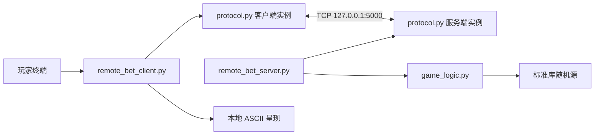
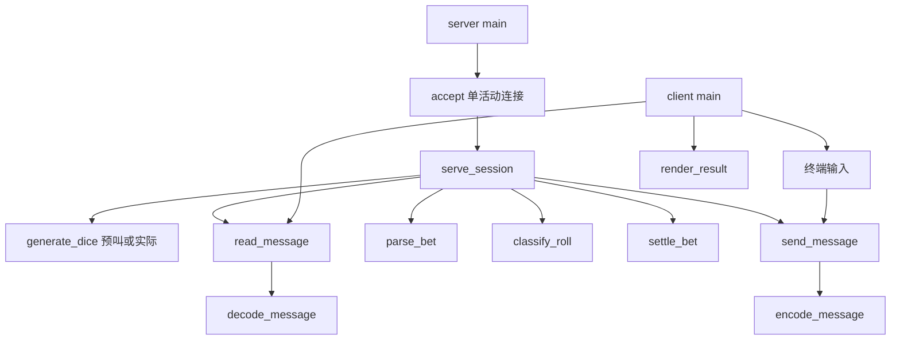
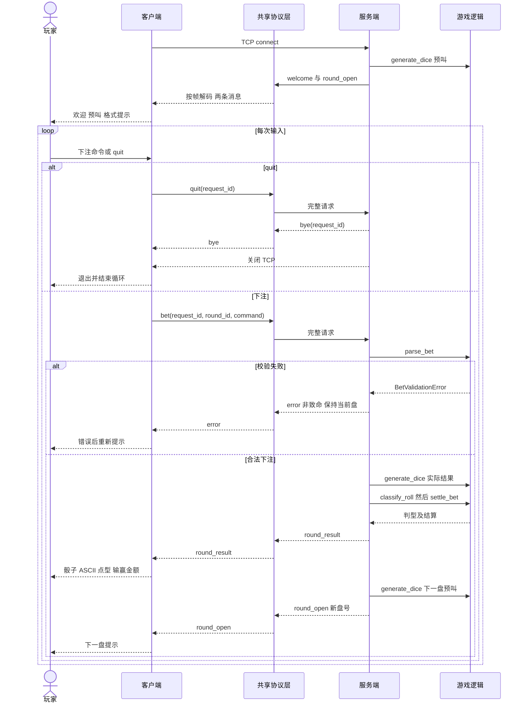

# RemoteBet 架构设计

状态：已实现。用户已授权开发并确认 [规则 A1](game-rules.md)，原歧义及确认记录见 [需求登记表](requirements.md#6-待确认登记表唯一编号)。

局域网扩展：客户端省略host时先输入IPv4:端口，parse_endpoint校验后再调用run_client；格式错误不发起连接，回车使用127.0.0.1和--port指定的默认端口，quit/EOF/Ctrl-C取消。显式host及--port沿用原行为。服务端可用既有--host 0.0.0.0参数监听局域网；未新增并发或改动TCP消息结构。Windows启动步骤和未验证范围见README。

## 1. 实际与目标结构

开始检查时仅有 `.git`，没有既有代码可重构。文档阶段新增六份 `docs/*.md` 后，已授权开发四个根模块、README.md、tests/及开发记录；没有重构已有代码或创建uv配置。当前两入口可运行。

## 2. 结构和依赖

protocol.py 两端共用同一消息规范和实现，不是两个服务。客户端不导入 game_logic.py；它只从权威结果构造展示。协议层不依赖游戏逻辑，游戏逻辑不依赖 socket 或终端。没有业务框架、泛型消息总线或依赖注入容器。

上图表示调用依赖，不是执行先后；实际顺序见时序图。服务端对有效下注才调用实际掷骰。

## 3. 模块职责与接口契约

下表对应当前实现。规则结果使用冻结dataclass，协议消息使用dict；不引入通用抽象基类。

| 模块 | 接口约定 | 输出及错误职责 |
|---|---|---|
| protocol.py | encode_message(message) → bytes；decode_message(frame_bytes) → Message | 完整信封/消息结构校验；编码结果含 LF，解码输入不含 LF；非法数据产生 ProtocolError(code) |
| protocol.py | read_message(sock, reader_state, deadline) → Message；send_message(sock, message) → None | reader_state 为每连接独立缓冲和半帧计时；保留粘连残留；有序读取完整帧，EOF/超时/传输错误向调用者报告；不把半帧当消息 |
| game_logic.py | generate_dice(draw_int) → DicePair | draw_int 接收闭区间下上界并返回整数；每组调用两次；生产使用 SystemRandom 的抽样方法，测试可传固定序列函数，无需容器 |
| game_logic.py | parse_bet(command) → Bet | 规范化 play、amount、currency；无 socket、无 print；业务失败 BetValidationError(code) |
| game_logic.py | classify_roll(predicted_dice, actual_dice) → Classification | 无随机、无副作用，返回原始匹配、最终点型和资格；无效骰子为内部契约错误 |
| game_logic.py | settle_bet(bet, classification) → Settlement | 纯整数计算；返回输赢、赔率、总返还、净变化；规则固定后测试 |
| remote_bet_server.py | serve_session(sock) → None | 创建连接状态、预叫、盘号；分派请求、校验 ID、调用逻辑、组合响应、清理；业务异常映射非致命 error，内部错误尽力映射 INTERNAL_ERROR 后关闭 |
| remote_bet_client.py | run_client(host, port) → exit_status；render_result(result) → string | CLI 参数、输入与输出、请求关联校验；显示服务端值及 ASCII；EOF、断线、协议错误有可读提示，不能修改中奖判定 |

Message 的具体形状仅由 [protocol.md](protocol.md) 定义。协议层检查字段类型/协议边界；command的长度、CR/LF及内容按协议明确交给parse_bet，返回可恢复业务错误。服务端检查会话状态和当前盘，客户端检查响应关联。错误码同协议，不重复维护另一套线协议枚举。内部契约错误不冒充玩家输入错误。

## 4. 关键数据结构和状态

- DicePair：有序两整数元组，均在 1～6。
- Bet：play、amount、currency；amount 是数量，不是余额。
- Classification：matched_types、final_type、eligible_types，含义唯一来自规则文档。
- Settlement：outcome、multiplier、payout、net_change；总额关系由规则文档定义。
- SessionState为概念状态，不单独建类：serve_session的局部round_id、predicted、last_request_id和reader构成它，循环位置表示OPEN/SETTLING；仅该连接拥有。不存账号、账本或跨连接恢复信息。
- reader_state：未消费字节缓冲、残片起始单调时间；读取下一条时先使用缓冲中已有帧，不能先阻塞 recv。
- 盘快照：Bet、预叫、实际结果、Classification、Settlement，在一次成功处理内只生成一次；传输失败不重掷。

生命周期为 CONNECTED → OPEN → SETTLING → OPEN，或任一通信错误 → CLOSED。OPEN 的业务校验失败仍为 OPEN，合法 quit 则 CLOSED。SETTLING 不读取新的终端输入，顺序完成当前处理；无多线程竞争。每次成功结算后发送结果，再生成下盘预叫及 round_open；即使下一盘生成失败，前盘结果仍保持已结算，随后关闭。

## 5. 完整游戏时序

协议层在图中集中绘制以便阅读，实际两端各有自己的 socket 和 reader_state。任一传输步骤失败均关闭本会话，客户端显示未完成/结果未知，不发送另一笔下注作为补偿。图中循环在 quit 后终止，不继续下一轮。

## 6. 单客户端边界与扩展

服务端同步 accept，一次仅处理一个活动连接。监听 backlog 不是多客户端支持；其他连接可能等待或连接超时，MVP 不保证即时拒绝提示。当前连接退出后服务端可接受下一个，盘号和请求序列重置。

未来多客户端需先定义独立桌还是共享桌、状态所有权、隔离、资源限制和同步策略；不能直接把当前逻辑放进多个线程再共用 SessionState。协议可复用，但没有保证房间、身份和共享账本语义。当前不做并发、身份、余额持久化、重试恢复、网络加密、公网部署或服务发现。
